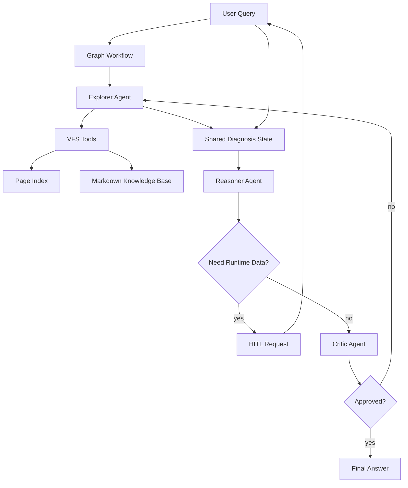

# MultiAgentFileAnalysis 项目架构

## 1. 项目定位

MultiAgentFileAnalysis 面向知识库构建与智能 QA 场景，核心思想是用 Agentic RAG 替代传统“切块、向量化、相似度召回”的检索方式。系统把知识库组织成一个受控的虚拟文件系统，让大模型通过有限工具逐步查看目录、读取文件、精确检索关键词，并在多智能体协作下生成可追溯、可审查的回答。

当前阶段只搭建大致架构，先确定职责边界和数据流，不实现具体检索、模型调用和业务细节。

## 2. 核心原则

1. 数据与操作分离：知识库文件本身不直接暴露给 Agent，Agent 只能通过受控协议访问静态索引和文档内容。
2. 精确检索优先：用字符级搜索和目录路标降低幻觉风险，不以语义相似度作为唯一证据来源。
3. 多智能体解耦：探索、推理、审查拆分到不同角色，避免单体模型上下文膨胀和自我确认。
4. 人在回路：系统不直接操作真实环境；需要外部状态时只生成确认请求，由用户执行并回填结果。
5. 全链路可追溯：每次目录访问、文件读取、关键词搜索、推理结论和审查意见都应进入状态记录。

## 3. 总体架构



## 4. 目录结构

```text
.
├── configs/
│   └── page_index.example.yaml
├── docs/
│   └── architecture.md
├── knowledge_base/
│   └── README.md
├── src/
│   └── multi_agent_file_analysis/
│       ├── agents/
│       │   ├── base.py
│       │   ├── critic.py
│       │   ├── explorer.py
│       │   └── reasoner.py
│       ├── graph/
│       │   ├── state.py
│       │   └── workflow.py
│       ├── hitl/
│       │   └── session.py
│       ├── index/
│       │   ├── loader.py
│       │   └── schema.py
│       ├── vfs/
│       │   └── protocol.py
│       ├── config.py
│       └── __init__.py
├── pyproject.toml
└── README.md
```

## 5. 模块职责

### 5.1 Index 层

Index 层负责描述知识库的虚拟目录结构。

- `page_index.yaml`：静态索引清单，定义虚拟路径、文件类型、摘要描述和真实文档映射。
- `index.schema`：定义目录节点、文件节点、索引元数据等核心结构。
- `index.loader`：后续负责读取、校验和构建索引对象。

### 5.2 VFS 层

VFS 层是 Agent 访问知识库的唯一入口。

- `v_ls(path)`：查看某个虚拟目录下的子项和摘要。
- `v_cat(path)`：读取某个虚拟文件的内容，并在实现阶段加入长度截断。
- `v_grep(path, pattern)`：在指定虚拟文件或目录范围内做精确关键词搜索。

这一层不向 Agent 暴露真实文件路径，后续可统一加入权限控制、审计日志和 Token 预算限制。

### 5.3 Agents 层

Agents 层只定义角色边界。

- `ExplorerAgent`：唯一允许调用 VFS 工具的角色，负责探索知识库并提取规则证据。
- `ReasonerAgent`：不直接检索文档，只基于用户问题、日志和 Explorer 的证据做诊断推理。
- `CriticAgent`：审查 Reasoner 的草案，检查结论是否被证据支持，发现幻觉或越权建议时驳回。

### 5.4 Graph 层

Graph 层负责流程编排和共享状态。

- `DiagnosisState`：保存用户问题、探索记录、证据、推理草案、审查意见、人在回路请求和最终回答。
- `workflow`：后续用于编排 Explorer、Reasoner、Critic、HITL 的状态流转。

### 5.5 HITL 层

HITL 层处理需要用户补充外部环境信息的场景。

- 当 Reasoner 发现缺少运行时状态时，生成一个明确、可执行、低风险的用户请求。
- 系统挂起当前诊断流程，等待用户粘贴命令结果、日志或配置片段。
- 用户补充的信息进入 `DiagnosisState`，再继续推理和审查。

## 6. 数据流

1. 用户提交问题、报错信息或日志。
2. Graph 初始化 `DiagnosisState`。
3. Explorer 根据问题线索调用 VFS 工具，读取目录路标、精确搜索关键词、抽取规则证据。
4. Reasoner 读取共享状态中的证据和用户上下文，生成诊断草案。
5. 如果缺少真实环境状态，Reasoner 生成 HITL 请求并暂停流程。
6. 用户回填信息后，Reasoner 继续推理。
7. Critic 审查草案与证据的一致性。
8. 审查通过则输出最终回答；不通过则带着审查意见回到 Explorer 或 Reasoner 继续补证。

## 7. 后续实现里程碑

1. 完成 Page Index schema 和 YAML 加载校验。
2. 实现 VFS 三个核心工具，并加入访问日志和内容截断。
3. 接入图状态机框架，跑通 Explorer -> Reasoner -> Critic 的最小闭环。
4. 加入 HITL 暂停与恢复机制。
5. 增加测试用知识库和端到端诊断样例。
6. 补充审计日志、错误处理、Token 预算和安全策略。
