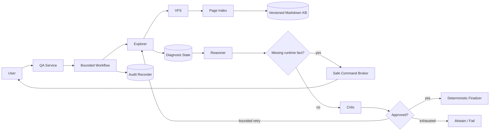
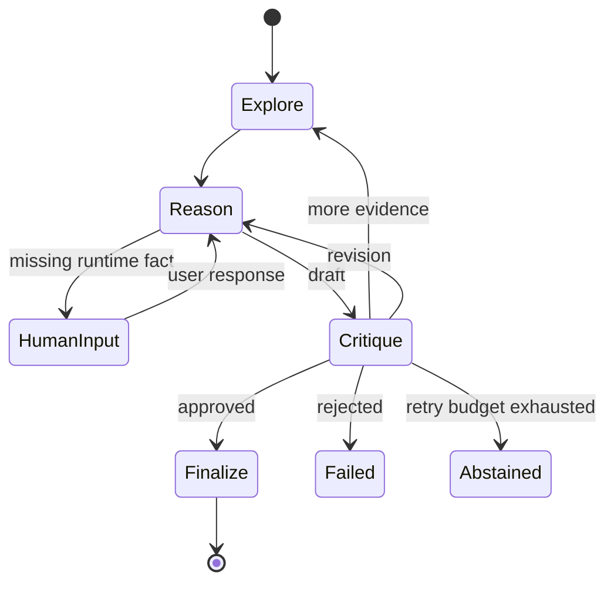

# MultiAgentFileAnalysis 架构说明

## 1. 定位与边界

项目处理配置符号密集、跨文档关联、存在版本和作用域差异的知识库问答与运维排错。系统使用只读虚拟文件接口把层级导航、词法召回、精确核验和后续可插拔检索统一在一个访问边界内。

当前目标是“降低无来源诊断并保留证据轨迹”，不是承诺零幻觉或绝对安全。

## 2. 组件与信任边界



知识库、用户日志和模型输出都被视为不可信输入。只有 Orchestrator 可以改变流程状态；只有 Explorer 能使用 VFS；Reasoner 不能修改原始证据；Critic 只能批准、要求补证、要求修改或拒绝。

## 3. 检索层

VFS 当前暴露：

- `v_ls`：单层、分页目录浏览，可按路标过滤；
- `v_search`：结合路径、标题、摘要、标签、别名、元数据和正文的有界词法搜索；
- `v_grep`：对文件或目录范围进行大小写可配置的字面搜索；
- `v_cat`：从指定行开始读取有界内容；
- `v_read_range`：读取明确的行范围。

VFS 不直接向 Agent 暴露真实路径。Page Index 的 `source` 经 `Path.resolve()` 后必须仍位于知识库根目录；符号链接和 `..` 不能绕过边界。

当前 `v_search` 是轻量词法实现，不是完整 BM25。后续可在保持 VFS 输入输出不变的前提下替换为 FTS5/BM25，并把语义召回作为候选发现通道。最终证据仍必须落到原文。

## 4. 证据模型

Explorer 提交的自由文本不能直接成为证据。系统必须验证引句在索引源文件中逐字存在，然后生成：

```text
source_path
line_start / line_end
exact_quote
section
source_version
retrieval_query
applicability_conditions
content_hash
verified
```

Reasoner 和 Critic 使用 `citation_key` 引用证据。相同路径但不同版本、章节或条件不能被视为等价规则。

## 5. 工作流



每个阶段、搜索结果、文件大小、用户输入、审查次数和总迭代数都有上限。恢复流程从 Reasoner 继续，不会重新执行 Explorer 并重复证据。

## 6. HITL 与命令安全

Reasoner 可以说明缺少什么现场事实，并可提出一个命令候选。`SafeCommandBroker` 使用确定性规则检查：

- 可执行文件和只读子命令白名单；
- 禁止 `sudo`；
- 禁止管道、重定向、命令替换和多命令组合；
- 禁止启动、停止、重启、编辑等状态变更；
- `journalctl` 必须限制输出行数。

未通过门禁的命令不会展示，但信息请求本身仍可发送。用户回填内容被记录为“未验证运行时观察”，不会冒充知识库规则。

## 7. 审查与最终输出

Critic 在模型审查前先执行确定性检查：

1. 是否存在已验证证据；
2. 草案是否引用证据；
3. 引用是否对应现有证据路径或行号；
4. 状态变更建议是否包含风险与回滚提示。

模型审查解析失败时保持未批准。只有 `APPROVED` 的结构化草案能进入 Finalizer；Finalizer 以确定性方式生成用户最终看到的文本，审查后不再调用模型润色。

## 8. 当前限制

- 词法排序仍较轻量，尚未实现 BM25、交叉编码重排或语义召回；
- 当前状态保存在进程内，Web 服务需要持久化会话与租户隔离；
- 命令白名单只覆盖少量诊断工具；
- 入库只支持本地 Markdown 和纯文本；
- 缺少基于真实官方快照的评测集；
- 尚未报告相对单 Agent、BM25 和混合检索的准确率、成本与延迟。
