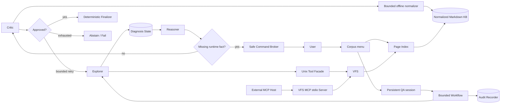
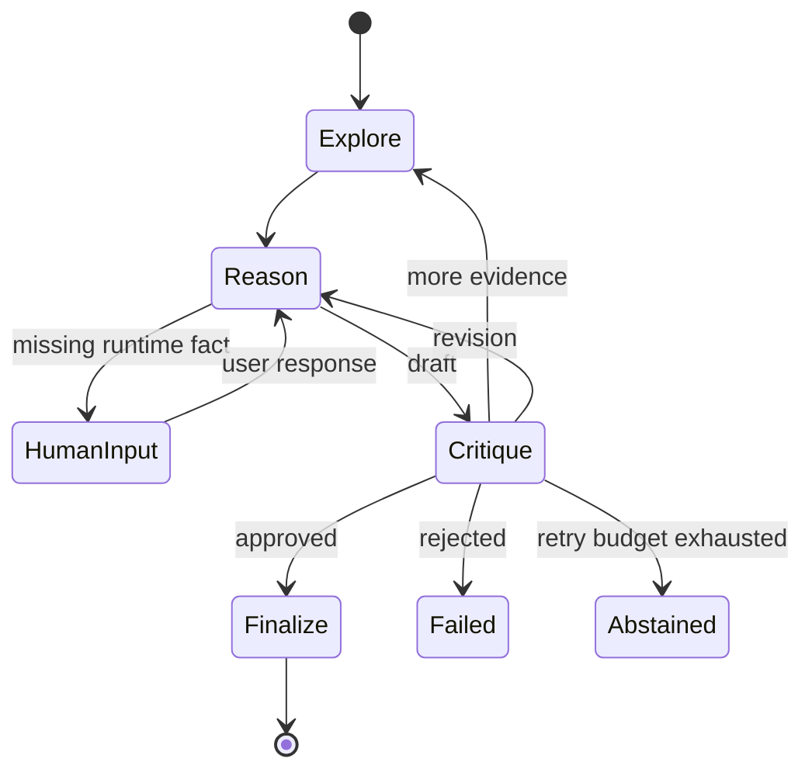

# MultiAgentFileAnalysis 架构说明

## 1. 定位与边界

项目处理配置符号密集、跨文档关联、存在版本和作用域差异的知识库问答与运维排错。系统使用只读虚拟文件接口把层级导航、词法召回、精确核验和后续可插拔检索统一在一个访问边界内。

当前目标是“降低无来源诊断并保留证据轨迹”，不是承诺零幻觉或绝对安全。

## 2. 组件与信任边界



知识库、用户日志和模型输出都被视为不可信输入。只有 Orchestrator 可以改变流程状态；只有 Explorer 能使用 VFS；Reasoner 不能修改原始证据；Critic 只能批准、要求补证、要求修改或拒绝。

主入口在每次启动时扫描当前 `knowledge_base/`：CHM 导入结果由 `manifest.json`
识别，普通顶层 Markdown 目录自动识别，嵌套知识库由就地
`.mafa-corpus.yaml` 声明边界。这里不存在中央路径清单。用户选择后，系统以选中
目录作为新的 `knowledge_base_root`，临时生成仅包含该目录的 Page Index，再装配
VFS 和工作流。因此未选中的语料不会成为 VFS 节点。一个交互进程可以顺序创建
多个独立问题 run，但共享同一个已选语料、LLM 客户端和检索缓存；只有等待 HITL
回填时才恢复当前 run。

## 3. Unix 工具与检索层

Explorer 通过模型原生 function calling 看到一个根目录为 `/` 的只读 Unix 风格
工作区。公开工具为：

- `pwd` / `cd`：维护单次 Explorer 运行的虚拟当前目录；
- `ls` / `find` / `stat`：浏览目录、按 glob 查找节点并读取索引元数据；
- `cat` / `head` / `tail`：有界读取文本；
- `grep`：递归字面匹配已索引文件；
- `search`：路径、标题、摘要、标签、别名、元数据和正文联合排序；
- `record_evidence`：把逐字引句提交给 VFS 核验。

每轮 Explorer 开始前，先由模型生成有界的结构化检索计划：证据义务、必须逐字
`grep` 的专名和用于通用规则发现的短查询。该计划只是工具执行约束，不是证据；
系统先通过同一只读 VFS 执行计划中的精确 `grep` 和发现性 `search`，再把真实结果
作为检索种子交回 Explorer。每个 `record_evidence` 调用必须把引文绑定到它直接
支持的计划义务；任一义务仍未覆盖时 Explorer 不能宣告检索完成。工具预算耗尽后，
已有证据仍会交给 Reasoner 形成显式的部分草稿，但不能绕过 Critic 进入 Finalize。
Critic 仍会语义审查
这种绑定，模型声称“支持”本身不构成证明。专名和查询均由模型按语义识别，检索层
不编码“某类词以后缀结尾”之类的领域规则。

这些是结构化函数，不会执行同名 Linux 二进制或任意 Shell。模型不支持原生工具
调用时，Explorer 可使用相同公开名称的 JSON 文本协议回退。

Unix 门面内部映射到 VFS 原语：

- `v_ls`：单层、分页目录浏览，可按路标过滤；
- `v_search`：结合路径、标题、摘要、标签、别名、元数据和正文的有界词法搜索；
- `v_grep`：对文件或目录范围进行大小写可配置的字面搜索；
- `v_cat`：从指定行开始读取有界内容；
- `v_read_range`：读取明确的行范围；
- `v_find` / `v_stat`：受预算约束的节点查找与元数据读取。

VFS 不直接向 Agent 暴露真实路径。Page Index 的 `source` 经 `Path.resolve()` 后必须仍位于知识库根目录；符号链接和 `..` 不能绕过边界。

同一组 VFS 原语还由一个独立的 MCP stdio 适配层对外提供。MCP Server 在启动时只
注入一个已校验的 `VirtualFileSystem`，不装配 LLM、Agent、HITL 或完整 QA 应用；
因此 MCP Host 不能借此越过当前 Page Index，也不能调用 Shell。公开 Tool 为
`v_ls`、`v_cat`、`v_read_range`、`v_grep`、`v_search`、`v_find`、`v_stat`、
`verify_quote` 和 `get_metadata`。每个 Tool 都带只读、非破坏、幂等和封闭世界
annotations，并返回结构化结果。stdio 进程由 `mafa-vfs-mcp` 或 `mafa mcp` 启动。

内部 Explorer 目前继续使用带 `pwd/cd/head/tail` 会话语义的 Unix 门面；外部 MCP
接口使用无会话当前目录的 VFS 绝对虚拟路径。两者共用同一个 VFS 策略与预算，不复制
文件读取逻辑。`record_evidence` 仍由 Orchestrator 管理，因为它会改变单次诊断状态，
不是一个无状态的只读文件系统操作。

当前 `v_search` 是轻量词法实现，不是完整 BM25。它首次使用时为已登记正文和元数据
建立内存倒排目录，以 ASCII token/trigram 和中文 bigram 排序出有界候选集，再执行
现有的逐页词法评分；同一文件的摘要位置按多个查询词的局部共现程度选择，避免更早的
泛泛提及遮住后文的具体规则段落。`grep` 支持命中数上限，并保持完整、有界的逐字
扫描语义。后续可在保持 VFS
输入输出不变的前提下替换为 FTS5/BM25，并把语义召回作为候选发现通道。最终证据
仍必须落到原文。

## 4. CHM 离线规范化

CHM 被视为不可信的输入容器，而不是 Agent 可直接访问的文件系统。`ingest-chm`
执行以下过程：

```text
ITSF/CHM
  → 无 Shell 的 extract_chmLib 子进程 + 时间/文件数/字节预算
  → 拒绝符号链接、越界路径和非 CHM 魔数
  → BOM/meta 编码识别，GB2312/GBK 统一按 GB18030 解码
  → 解析 .hhc 层级目录
  → HTML → GFM Markdown（包括表格、列表、代码、链接和图片）
  → 注入来源 frontmatter、CONTENTS.md 与 manifest.json
  → 暂存目录完成后原子发布
  → 重建 Page Index
```

表格中的 `rowspan` 和 `colspan` 会扩展为矩形网格并重复单元格内容，因为 GFM 本身
不表达合并单元格。脚本、对象、隐藏节点、危险 scheme 与可携带主动内容的 SVG
资源不进入知识库。缓存键包含归档名称与 SHA-256、manifest/转换器版本、资源复制
选项和单页大小上限。

## 5. 证据模型

Explorer 提交的自由文本不能直接成为证据。系统必须验证引句在索引源文件中逐字存在，然后生成：

```text
source_path
line_start / line_end
exact_quote
section
source_version
retrieval_query
applicability_conditions
supports_obligations
content_hash
verified
```

Reasoner 和 Critic 使用 `citation_key` 引用证据。相同路径但不同版本、章节或条件不能被视为等价规则。
用户问题和补充描述只用于界定检索目标或表达尚未验证的现场状态，不能替代来源证据。
当用户描述与已核验原文冲突时，系统对文档规则以原文为准，并在结论中保留冲突与
适用范围。

## 6. 工作流



每个阶段、搜索结果、文件大小、用户输入、审查次数和总迭代数都有上限。Critic
只要列出 `missing_evidence`，结构化路由就统一归一为补证并返回 Explorer；只有
证据已经充足而草案表达或操作仍有问题时才返回 Reasoner 修改。恢复流程从 Reasoner
继续，不会重新执行 Explorer 并重复证据。

`COMPLETED` 只返回 Critic 已批准的最终答案。`WAITING_FOR_HUMAN`、`FAILED` 或
`ABSTAINED` 则由确定性 partial renderer 输出阶段性回答：保留最后的暂定断言、
已核验原文、未解决前提与暂停/终止原因，并明确标注未经最终审查；为避免泄漏危险
建议，不渲染未批准草稿中的操作列表。QA API 通过 `QAResponse.is_partial` 区分两者。

## 7. HITL 与命令安全

Reasoner 可以说明缺少什么现场事实，并可提出一个命令候选。`SafeCommandBroker` 使用确定性规则检查：

- 可执行文件和只读子命令白名单；
- 禁止 `sudo`；
- 禁止管道、重定向、命令替换和多命令组合；
- 禁止启动、停止、重启、编辑等状态变更；
- `journalctl` 必须限制输出行数。

未通过门禁的命令不会展示，但信息请求本身仍可发送。用户回填内容被记录为“未验证运行时观察”，不会冒充知识库规则。

## 8. 审查与最终输出

Critic 在模型审查前先执行确定性检查：

1. 是否存在已验证证据；
2. 草案是否引用证据；
3. 引用是否对应现有证据路径或行号；
4. 状态变更建议是否包含风险与回滚提示。

模型审查解析失败时保持未批准。只有 `APPROVED` 的结构化草案能进入 Finalizer；Finalizer 以确定性方式生成用户最终看到的文本，审查后不再调用模型润色。

## 9. 当前限制

- 词法排序仍较轻量，尚未实现 BM25、交叉编码重排或语义召回；
- 当前状态保存在进程内，Web 服务需要持久化会话与租户隔离；
- 命令白名单只覆盖少量诊断工具；
- CHM 转换依赖外部 `extract_chmLib`，复杂 CSS 布局、交互部件和专有对象不会保真；
- GFM 无法原生表示合并单元格，当前策略是重复填充值；
- 倒排目录当前驻留内存且首次查询才构建，大型语料应迁移到持久化 FTS/BM25；
- Unix 工具是 VFS 门面，不是通用 Shell，也不访问宿主机；
- 缺少基于真实官方快照的评测集；
- 尚未报告相对单 Agent、BM25 和混合检索的准确率、成本与延迟。
